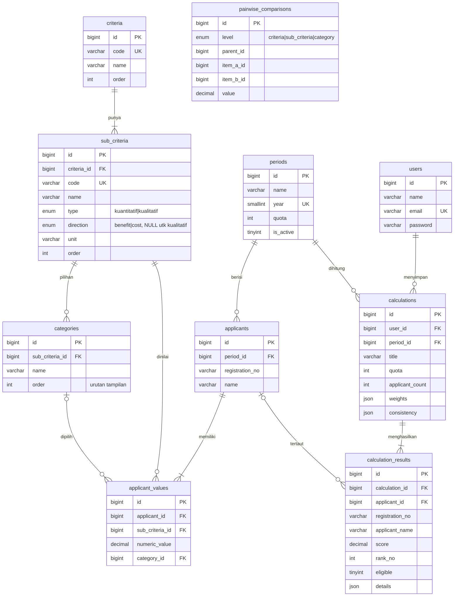

# ERD — DSS Beasiswa Bidikmisi (AHP)

Gambar ERD: [ERD.svg](ERD.svg) (dibuat ulang sesuai migration terbaru).
SVG bisa dibuka di browser atau dimasukkan ke Word (Insert → Pictures).

## Kelompok tabel

| Kelompok | Tabel | Fungsi |
|---|---|---|
| Model AHP | `criteria`, `sub_criteria`, `categories`, `pairwise_comparisons` | Hierarki kriteria dan penilaian perbandingan berpasangan |
| Alternatif | `periods`, `applicants`, `applicant_values` | Periode seleksi, pendaftar, dan nilai tiap sub-kriteria |
| Hasil | `calculations`, `calculation_results` | Riwayat perhitungan (snapshot) dan ranking |
| Akses | `users` | Login |

## Relasi

| Induk | Anak | Kardinalitas | ON DELETE | Keterangan |
|---|---|---|---|---|
| `criteria` | `sub_criteria.criteria_id` | 1 : N | CASCADE | Kriteria punya banyak sub-kriteria |
| `sub_criteria` | `categories.sub_criteria_id` | 1 : N | CASCADE | Pilihan jawaban sub-kriteria kualitatif |
| `sub_criteria` | `applicant_values.sub_criteria_id` | 1 : N | CASCADE | Nilai pendaftar per sub-kriteria |
| `categories` | `applicant_values.category_id` | 0..1 : N | SET NULL | Hanya untuk sub-kriteria kualitatif |
| `periods` | `applicants.period_id` | 1 : N | RESTRICT | Pendaftar milik satu periode |
| `applicants` | `applicant_values.applicant_id` | 1 : N | CASCADE | Nilai ikut terhapus bersama pendaftar |
| `periods` | `calculations.period_id` | 1 : N | RESTRICT | Perhitungan untuk satu periode |
| `users` | `calculations.user_id` | 1 : N | CASCADE | Riwayat milik user |
| `calculations` | `calculation_results.calculation_id` | 1 : N | CASCADE | Hasil tiap pendaftar |
| `applicants` | `calculation_results.applicant_id` | 0..1 : N | SET NULL | Riwayat tetap utuh walau pendaftar dihapus |

`pairwise_comparisons` tidak memakai foreign key karena satu tabel dipakai untuk tiga level (polimorfik):

| `level` | `item_a_id` / `item_b_id` | `parent_id` |
|---|---|---|
| `criteria` | `criteria.id` | NULL |
| `sub_criteria` | `sub_criteria.id` | `criteria.id` |
| `category` | `categories.id` | `sub_criteria.id` |

Kebalikannya (B vs A = 1/nilai) tidak disimpan. Data yatim dibersihkan oleh aplikasi saat kriteria, sub-kriteria, atau kategori dihapus.

## Aturan unik

- `criteria.code`, `sub_criteria.code`, `periods.year`, `users.email`
- `categories (sub_criteria_id, name)`
- `applicants (period_id, registration_no)` — no. pendaftaran unik per periode
- `applicant_values (applicant_id, sub_criteria_id)` — satu nilai per sub-kriteria
- `pairwise_comparisons (level, item_a_id, item_b_id)`

## Diagram (Mermaid)

Tipe data mengikuti MySQL (seperti ERD awal). Proyek saat ini memakai SQLite; strukturnya sama.
Kolom `created_at` dan `updated_at` ada di semua tabel (tidak ditulis di Mermaid agar ringkas).
